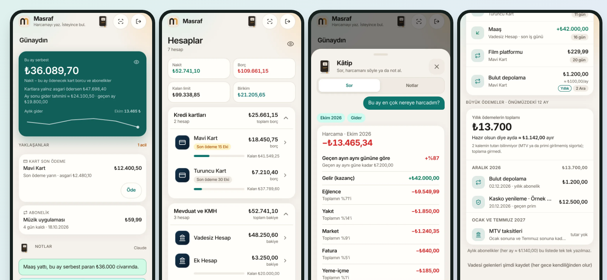

# Masraf: a personal money tracker (case study)

**A progressive web app that answers one question first: how much can I actually spend this month, after card bills, instalments and subscriptions?**

**Read the full case study:** https://mkemalkahraman.github.io/masraf-case-study/

## At a glance

- Single-user PWA that installs from the browser and runs on a phone home screen
- Next.js 16, React 19, Supabase (Postgres, Auth, Storage), Claude API
- All money logic runs in Postgres functions, in one transaction per change
- Row-level security, email one-time-code sign-in, hashed on-device PIN, encrypted weekly backups
- 1,500+ unit tests and about 390 database tests
- An in-app assistant that answers from server-calculated figures; the language model only classifies the question

## What it does

- **Overview:** one number for what is left to spend this month, with upcoming card payments and subscriptions right under it
- **Accounts:** cards, overdrafts, a loan and savings in one list, each behaving the way its bank does
- **Analysis:** a month's spending sorted by size, compared with the previous month, by purchase month or by payment month
- **Add:** type an amount, scan a receipt, record a payment between accounts or log a fuel stop
- **Subscriptions:** monthly and yearly items, plus a twelve-month calendar of the large yearly payments
- **Assistant:** ask in plain language; every figure is calculated on the server and the assistant never writes data

## Lessons from real bugs

- **A comma that silently changed the amount:** a number field dropped the Turkish decimal comma; amount fields are now text inputs with their own parser and tests
- **Matching the bank to the kuruş:** savings interest was reproduced from a formula and checked against real statements until the totals matched exactly
- **Pop-ups that had no background:** an undefined style class produced no CSS and no error; the build now fails when a class has no style behind it
- **Twelve requests where one was needed:** the notes card fired a dozen parallel AI requests; the request log, not the code, found it

Details for each lesson are on the [case study page](https://mkemalkahraman.github.io/masraf-case-study/#lessons).

## About this repository

- **No source code is published here.** This is a case study only.
- **All screenshots use invented data.** Account names, amounts and the vehicle are made up for this page.
- The app's interface is in Turkish because it was built for a Turkish household and Turkish banks.

## Credit

Built with Claude as a pair programmer. Product decisions, real-world money rules and testing on a real phone are mine.
