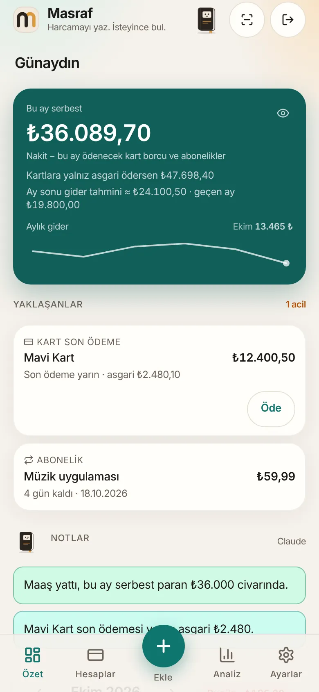
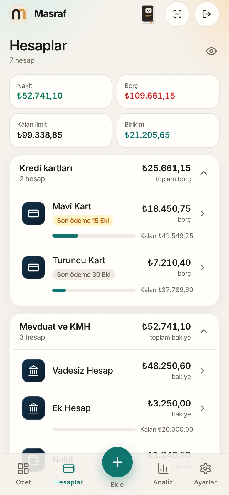
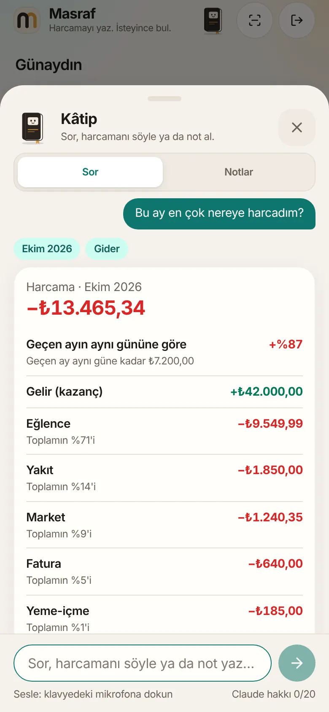
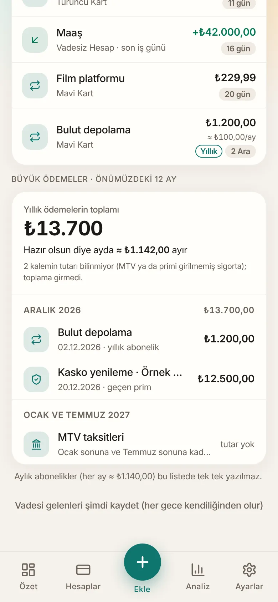

# Masraf: a personal money tracker (case study)

**A progressive web app that answers one question first: how much can I actually spend this month, after card bills, instalments and subscriptions?**

  
  
  
  

**Read the full case study:** https://mkemalkahraman.github.io/masraf-case-study/

## At a glance

- Single-user PWA that installs from the browser and runs on a phone home screen
- Next.js 16, React 19, Supabase (Postgres, Auth, Storage), Claude API
- All money logic runs in Postgres functions, in one transaction per change
- Row-level security, email one-time-code sign-in, hashed on-device PIN, encrypted weekly backups
- 1,500+ unit tests and about 390 database tests
- An in-app assistant that answers from server-calculated figures; the language model only classifies the question

## About this repository

- **No source code is published here.** This is a case study only.
- **All screenshots use invented data.** Account names, amounts and the vehicle are made up for this page.
- The app's interface is in Turkish because it was built for a Turkish household and Turkish banks.

## Credit

Built with Claude as a pair programmer. Product decisions, real-world money rules and testing on a real phone are mine.
